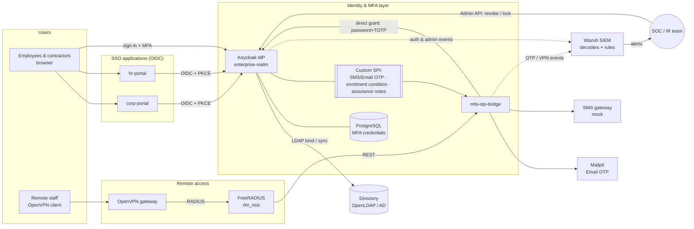
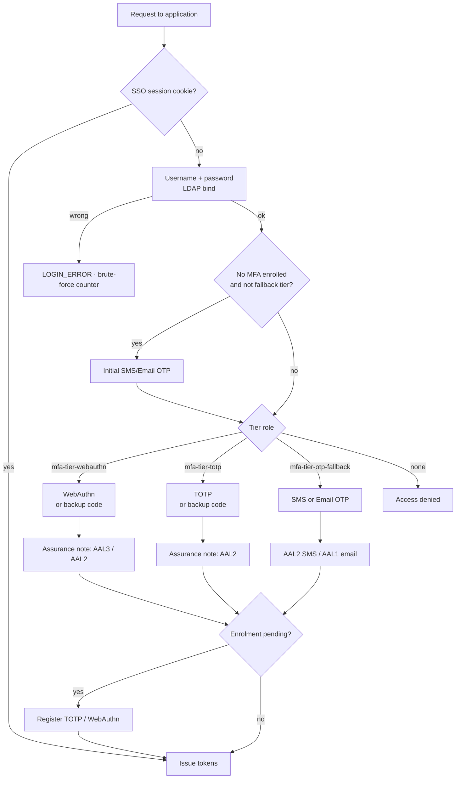
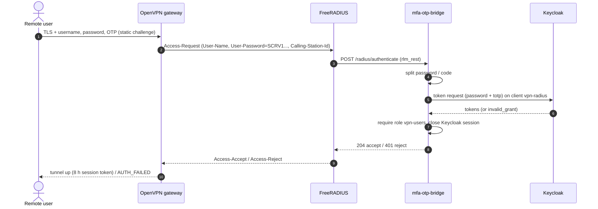
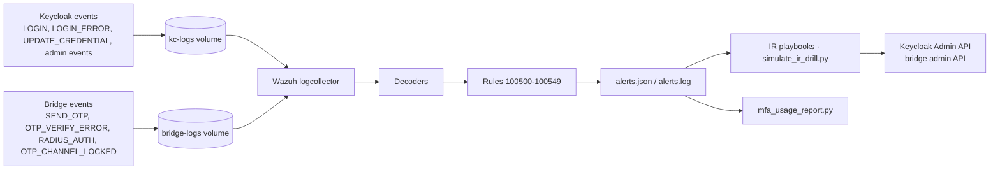

# 02 — MFA Solution Design Document

**Scope:** selected MFA methods, integration with the directory (Active Directory role, simulated by OpenLDAP), SSO and VPN/remote access, the security-usability balance, accessibility, and architecture diagrams.
**Implements:** recommendations R1–R7 of the Assessment Report (01).

---

## 1. Design goals

1. Every interactive sign-in uses two factors; no untiered account can sign in (FR-01, SR-02).
2. The strength of the second factor follows the risk of the user: phishing-resistant for privileged users (SR-01).
3. Users sign in once per working day for all web applications (FR-07, UX-01).
4. Remote access cannot be opened with a password alone (FR-08).
5. Everyone can use at least one factor, including users without smartphones and screen-reader users (AC-01…AC-06).
6. Every authentication outcome is logged and monitored (SR-07).

## 2. Solution components

| Component | Product (lab) | Role |
|---|---|---|
| Directory | OpenLDAP `osixia/openldap:1.5.0` (stands in for Active Directory) | Source of users, passwords, departments, phone numbers and group memberships |
| Identity provider (IdP) | Keycloak 26.0.7, realm `enterprise-realm`, PostgreSQL | Federation, MFA policy, SSO, token issuance, event logging, brute-force protection |
| Custom IdP extensions | Java SPI `mfa-bridge-authenticator` | SMS/Email OTP authenticator, "no MFA enrolled yet" condition, assurance-note step |
| OTP service | `mfa-otp-bridge` (Python FastAPI) | Generates, delivers and verifies SMS/Email OTPs; RADIUS adapter; OTP channel lock |
| Email channel | Mailpit (local SMTP + inbox) | Receives Email OTPs |
| SMS channel | Mock SMS gateway inside the bridge (`/sms/inbox`) | Stands in for a commercial SMS provider |
| SSO applications | `corp-portal` (:5000), `hr-portal` (:5001) — OIDC clients | Sample enterprise applications |
| Remote access | OpenVPN 2.6 + FreeRADIUS 3.2 (`rlm_rest`) | VPN gateway delegating password + OTP checks |
| Monitoring | Wazuh manager 4.9 with custom decoders/rules | Collects Keycloak and bridge events, raises alerts |

## 3. MFA method selection

### 3.1 Comparison of the five methods

| Criterion | SMS OTP | Email OTP | App-based TOTP | Biometrics (WebAuthn platform) | Hardware token (FIDO2 key) |
|---|---|---|---|---|---|
| Factor proved | Possession of phone number | Access to mailbox | Possession of enrolled phone | Possession of device + inherence (fingerprint/face) | Possession of key (+ PIN) |
| Phishing resistance | None — code can be relayed | None — code can be relayed | None — code can be relayed | **Yes** — bound to the site origin | **Yes** — bound to the site origin |
| Main threats | SIM swap, SS7 interception, OTP bombing | Mailbox compromise (often same password), forwarding rules | Real-time phishing proxy, seed theft at enrolment | Device theft (mitigated by user verification) | Loss/theft (mitigated by PIN) |
| Internal assurance level (§3.3) | AAL2 | AAL1 | AAL2 | AAL3 | AAL3 |
| Cost per user | Per-message fee | ~0 | 0 (free apps) | 0 (built into laptops/phones) | ~USD 25–55 per key, 2 per user |
| Needs a smartphone | No (any mobile phone) | No | Yes | No (laptop sensor) | No |
| Works offline | No (needs mobile signal) | No | **Yes** | Yes | Yes |
| User effort per sign-in | Wait + type 6 digits | Switch to mail + type 6 digits | Open app + type 6 digits | Touch / glance | Insert + touch |
| Accessibility | Good with screen reader and SMS autofill; hard for deaf-blind users | **Best for screen-reader users** (mail client they already use) | Moderate (app switching, 30-s timer) | Good (no typing); not usable without a sensor | Good for motor-impaired users (single touch); needs USB/NFC access |
| Recovery if lost | Carrier SIM replacement | Mailbox recovery | Backup codes / re-enrol | Second key / backup codes | Second key / backup codes |

### 3.2 Selected methods per tier

| Tier (LDAP group → realm role) | Users | Primary factor | Recovery / fallback | Resulting assurance |
|---|---|---|---|---|
| `mfa-tier-webauthn` | Executive, Engineering, IT admins | **Biometrics** (platform WebAuthn) or **hardware token** (YubiKey) | Second registered key; backup codes (downgrade to AAL2, no admin access) | AAL3 |
| `mfa-tier-totp` | Finance, General staff with smartphones, Contractors | **App-based TOTP** (Google / Microsoft Authenticator) | Backup codes | AAL2 |
| `mfa-tier-otp-fallback` | Staff without a smartphone or with accessibility needs | **SMS OTP** or **Email OTP**, user's choice per sign-in | The other channel; helpdesk | SMS AAL2, Email AAL1 |
| *(no tier)* | Anyone not assigned | — | — | Access denied |
| **Initial authentication (all tiers)** | Any non-fallback user with no authenticator yet | **SMS or Email OTP** to the contact data in the directory, *before* enrolment is allowed | — | Session marked with the OTP method |

**Rationale.** Phishing-resistant factors protect the accounts attackers target most (whaling, admin takeover). TOTP gives strong, free, offline protection for the general workforce. SMS and Email OTP are deliberately limited to two roles — *initial verification* before enrolment and *fallback* for people who cannot use the other factors — because they can be relayed by a phishing proxy and SMS is exposed to SIM swap. Email OTP ranks lowest because a mailbox is often protected by the same password the attacker already holds; the portal therefore refuses Email-OTP sessions access to finance approvals.

### 3.3 Enterprise Corp assurance scale

Keycloak records the factor used and an internal assurance level as session claims `mfa_method` and `aal`, which applications can enforce:

| Level | Meaning | Methods | Example use in the lab |
|---|---|---|---|
| AAL1 | Password, or password + Email OTP | email-otp | Intranet reading |
| AAL2 | Password + possession factor | totp, sms-otp, recovery-code | `corp-portal /finance` |
| AAL3 | Password + phishing-resistant, cryptographic factor with user verification | webauthn | `corp-portal /admin` (plus `it-admins` role) |

### 3.4 Method parameters

| Method | Parameter | Value | Where |
|---|---|---|---|
| TOTP | Algorithm / digits / period / look-ahead | HmacSHA1 / 6 / 30 s / ±1 step; code reuse forbidden | realm `otpPolicy*` |
| | Why SHA-1 | Google and Microsoft Authenticator ignore SHA-256 parameters in the QR code; SHA-1 HMAC remains secure for OTP | |
| WebAuthn (2nd factor) | Algorithms / attachment / user verification / attestation | ES256, RS256 / any (platform or roaming) / preferred / not specified | realm `webAuthnPolicy*` |
| WebAuthn passkeys | Resident key / user verification | Required / required | realm `webAuthnPolicyPasswordless*` |
| SMS / Email OTP | Length / lifetime / attempts / storage | 6 digits (CSPRNG) / 300 s / 5 per code, single use / HMAC-SHA256 only | `mfa-otp-bridge` |
| | Send rate limit | 3 per minute, 10 per hour per user | `OTP_SEND_LIMIT_*` |
| Backup codes | Count / use | 12 single-use codes, generated by the user | Keycloak recovery authentication codes |
| Brute force (all) | Failures before lockout / wait / max wait / quick-login check | 10 / 60 s increment / 15 min / 1 s | realm `bruteForceProtected` |

## 4. Integration design

### 4.1 Directory (Active Directory role) integration

- **Pattern:** LDAP user federation, `editMode = READ_ONLY`, `importEnabled = true`. Passwords stay in the directory; Keycloak verifies them by LDAP bind, so no password migration is needed. In production the same configuration points at Active Directory (`vendor = ad`, `usernameLDAPAttribute = sAMAccountName`, LDAPS on 636).
- **Service account:** `cn=readonly` — least privilege, read-only (replaces the shared admin account used by legacy applications).
- **Attribute mappers:** `uid`→username, `mail`→email, `givenName`/`sn`→names, `mobile`→`mobile` (SMS destination), `departmentNumber`→`department` (token claim), `title`→`jobTitle`.
- **Group-to-role mapper:** LDAP `groupOfNames` entries under `ou=Groups` become realm roles: `mfa-tier-webauthn`, `mfa-tier-totp`, `mfa-tier-otp-fallback`, `it-admins`, `vpn-users`. Moving a user between tiers is a directory group change — no IdP change needed.
- **Sync:** changed-user sync every 5 min, full sync hourly; `setup_lab.sh` triggers an initial full sync.
- **MFA credentials** (TOTP seeds, WebAuthn public keys, backup codes) are stored by Keycloak, linked to the federated user, never in the directory.

### 4.2 Single sign-on integration

- **Protocol:** OpenID Connect authorization code flow with PKCE (S256) and confidential clients.
- **Clients:** `corp-portal` and `hr-portal`. After one sign-in, the Keycloak SSO session cookie lets the user open the second application without credentials (UX-01). SSO session: 30 min idle, 10 h maximum.
- **Tokens:** ID/access tokens carry `preferred_username`, `department`, `realm_roles`, `mfa_method`, `aal`; signatures are verified against the realm JWKS; issuer, audience and nonce are checked.
- **Authorisation by assurance:** the application enforces `aal ≥ AAL2` for `/finance` and `aal = AAL3` + `it-admins` for `/admin`.
- **Split URLs:** browsers use `http://localhost:8080`; containers call `http://keycloak:8080` (Keycloak `hostname-backchannel-dynamic`), so the issuer stays stable.

### 4.3 Authentication flow (browser)

`enterprise-browser` (bound as the realm browser flow):

1. **Cookie** — existing SSO session → done.
2. **Username + password** — verified by LDAP bind.
3. **Initial enrolment OTP** (conditional) — if the user has *no* TOTP/WebAuthn credential *and* is not in the fallback tier: SMS/Email OTP to the directory contact data must succeed before the enrolment required action is allowed (SR-03).
4. **Tier AAL3** (role `mfa-tier-webauthn`) — WebAuthn assertion, *or* backup code.
5. **Tier AAL2** (role `mfa-tier-totp`) — TOTP, *or* backup code.
6. **Tier fallback** (role `mfa-tier-otp-fallback`) — SMS or Email OTP.
7. **Default deny** — none of the three roles → access denied with a helpdesk message.

### 4.4 VPN and remote access integration

- OpenVPN accepts username + (password **and** one-time code), either in OpenVPN's static-challenge format (`SCRV1:base64(password):base64(code)`) entered by the client prompt, or as password followed by the 6 digits.
- OpenVPN's `auth-user-pass-verify` hook sends a RADIUS Access-Request to FreeRADIUS, whose `rlm_rest` module posts it to the bridge (`/radius/authenticate`, reachable only from the FreeRADIUS container).
- The bridge splits password and code and performs one Keycloak direct-grant exchange on client `vpn-radius` bound to flow `vpn-direct-grant` (username → password → TOTP). This keeps one policy point: VPN failures count toward Keycloak lockout and appear in the same event stream.
- Authorisation: the account must hold `vpn-users`. The Keycloak session is closed immediately; OpenVPN issues an 8-hour session token so reconnects do not re-prompt (UX-03).

### 4.5 Monitoring integration

Keycloak logs user and admin events (`jboss-logging` listener: success at INFO, errors at WARN) to `/var/log/keycloak/keycloak.log`; the bridge writes OTP, lock and RADIUS events in the same `key="value"` format to `/var/log/mfa/bridge-events.log`. Wazuh tails both through shared volumes and applies `siem/keycloak_decoders.xml` and `siem/keycloak_rules.xml` (details in 06).

## 5. Security and usability balance

| Decision | Security effect | Usability effect |
|---|---|---|
| Tiered methods by role | Strongest factor where the risk is highest | Most staff use a free app; executives just touch a sensor |
| SSO session (10 h max, 30 min idle) | One central session to revoke | One MFA prompt per working day |
| WebAuthn user verification "preferred" | Biometric/PIN normally used | Keys without a PIN still work |
| OTP rate limit 3/min, 10/h | Stops OTP bombing (MFA fatigue) | Legitimate users rarely need more than 2 codes |
| Codes valid 5 min, 5 attempts | Bounds guessing (5 in 10⁶ per code) | Enough time for screen-reader users |
| VPN session token 8 h | — | No re-prompt on reconnect or renegotiation |
| Initial OTP before enrolment | Stolen password cannot enrol attacker's authenticator | One extra step, only once |
| Backup codes downgrade to AAL2 | Recovery cannot reach admin functions | Users are never locked out of normal work |
| Clear error text, no account enumeration | Messages do not reveal whether a user exists | Messages state what to do next |

## 6. User experience and accessibility design

### 6.1 Enrolment and recovery journey

- **Self-service enrolment** at first sign-in: initial OTP → register authenticator (QR code for TOTP; "use this device / security key" for WebAuthn).
- **Account console** (`/realms/enterprise-realm/account`): add a second key, rename or remove authenticators, generate backup codes.
- **Backup codes:** 12 single-use codes shown once; users are told to print or store them in a password manager.
- **Remember-device:** the SSO session acts as the remembered device for the working day; no long-lived "trust this browser" cookie, because it would bypass MFA on shared and stolen devices.

### 6.2 Accessibility accommodations

| Need | Accommodation in the design |
|---|---|
| No smartphone (j.doe) | SMS to any mobile phone, or email; SMS fallback tier assigned through the directory |
| Screen reader / low vision (l.fernandes) | Email OTP in the mail client they already use; OTP pages use labelled inputs, real buttons, focus on the code field, errors announced through the page's live message region, `autocomplete="one-time-code"` and `inputmode="numeric"` |
| Motor impairment | WebAuthn needs one touch, no typing; hardware keys with NFC or USB-C to avoid fine insertion; no CAPTCHA |
| Cognitive load | One method per tier, plain-language instructions, "Send a new code" and "Use a different method" buttons, no countdown timers |
| Cannot use any standard factor | Documented exception process (05 §2.9) with compensating controls |

## 7. Architecture diagrams

### 7.1 Enterprise MFA reference architecture



### 7.2 Browser authentication flow decision logic



### 7.3 SSO with tiered MFA (sequence)

```mermaid
sequenceDiagram
  autonumber
  actor U as User
  participant CP as corp-portal
  participant KC as Keycloak
  participant AD as Directory
  participant HR as hr-portal
  U->>CP: GET /finance
  CP-->>U: 302 to /auth (state, nonce, PKCE challenge)
  U->>KC: username + password
  KC->>AD: LDAP bind as user
  AD-->>KC: success
  KC-->>U: second-factor page for the user's tier
  U->>KC: TOTP code / WebAuthn assertion / OTP
  KC-->>U: 302 to corp-portal/callback?code=...
  CP->>KC: POST /token (code, verifier, client secret)
  KC-->>CP: ID + access token (aal, mfa_method, roles)
  CP->>CP: verify signature, issuer, audience, nonce; check aal ≥ AAL2
  CP-->>U: /finance
  U->>HR: GET /login
  HR-->>U: 302 to /auth
  U->>KC: SSO cookie
  KC-->>U: 302 back with code (no prompt)
  HR->>KC: token exchange
  HR-->>U: signed in (same session)
```

### 7.4 Initial enrolment protected by OTP (sequence)

```mermaid
sequenceDiagram
  autonumber
  actor U as New user (p.nair)
  participant KC as Keycloak
  participant BR as mfa-otp-bridge
  participant M as Mailpit / SMS
  U->>KC: password (first sign-in)
  KC->>KC: condition-no-mfa-enrolled = true
  KC-->>U: choose SMS or email
  U->>KC: email
  KC->>BR: POST /otp/send (user, channel, destination)
  BR->>M: code (HMAC stored, 5 min TTL)
  M-->>U: 6-digit code
  U->>KC: code
  KC->>BR: POST /otp/verify
  BR-->>KC: valid
  KC-->>U: register authenticator (WebAuthn / TOTP QR)
  U->>KC: attestation / first TOTP
  KC-->>U: signed in; next sign-ins use the new authenticator
```

### 7.5 VPN with RADIUS and MFA (sequence)



### 7.6 Monitoring and response data flow



## 8. Data protection by design (GDPR)

- **Minimisation:** MFA uses data the directory already holds (email, mobile). OTP codes are never stored in clear; the bridge keeps only an HMAC for at most 5 minutes; logs show masked destinations (`*******007`, `j***@corp.enterprise.local`).
- **Biometrics stay on the device:** WebAuthn sends a signature, never a fingerprint or face template; Keycloak stores only a public key, so no biometric (special-category) data is processed centrally.
- **Security of processing:** MFA, cryptographic challenge-response (WebAuthn), brute-force limits and monitoring support Art. 32; mapping in 05.
