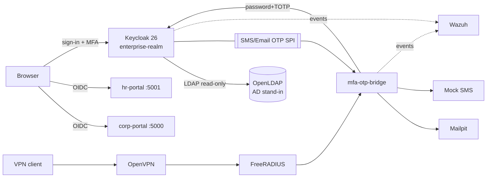

# Implementing a Robust Multi-Factor Authentication (MFA) System in an Enterprise Environment

Self-contained lab and documentation repository for Enterprise Corp (simulated multinational). Everything runs locally in Docker — no paid SaaS. Compliance scope: **GDPR** and **HIPAA**.

## Deliverables

| # | Deliverable | File |
|---|---|---|
| 1 | Assessment Report (current state, gaps, stakeholder requirements) | [docs/01_Assessment_Report.md](docs/01_Assessment_Report.md) |
| 2 | MFA Solution Design Document (methods, integration, UX/accessibility, Mermaid diagrams) | [docs/02_MFA_Solution_Design_Document.md](docs/02_MFA_Solution_Design_Document.md) |
| 3 | Implementation Plan (roadmap, pilot, phased rollout, training & awareness) | [docs/03_Implementation_Plan.md](docs/03_Implementation_Plan.md) |
| 4 | MFA Configuration Guides (5 methods + SSO + VPN) | [docs/04_MFA_Configuration_Guides.md](docs/04_MFA_Configuration_Guides.md) |
| 5 | Security Policies and Compliance (policy, SOPs, GDPR & HIPAA checklists) | [policies/05_Security_Policies_and_Compliance.md](policies/05_Security_Policies_and_Compliance.md) |
| 6 | Monitoring and Incident Response Plan (tool setup, IR plan, drill results) | [docs/06_Monitoring_and_Incident_Response_Plan.md](docs/06_Monitoring_and_Incident_Response_Plan.md) |

Run evidence (JSON/Markdown/logs) is written to `docs/evidence/` by the scripts.

## Lab at a glance



| Requirement | How the lab meets it |
|---|---|
| Baseline single-factor state | OpenLDAP with 5 OUs / 10 users; `/legacy` password-only login; `scripts/assess_baseline.py` |
| SMS OTP (initial + fallback) | Keycloak SPI → `mfa-otp-bridge` → mock SMS gateway (`/sms/inbox`) |
| Email OTP (initial + fallback) | same SPI → Mailpit |
| App-based OTP | TOTP (Google / Microsoft Authenticator) |
| Biometrics | WebAuthn platform authenticator (Windows Hello / Touch ID) |
| Hardware tokens | WebAuthn / FIDO2 roaming key (YubiKey) |
| Accessibility & UX | Backup (recovery) codes, SMS/Email fallback tier, accessible OTP pages, SSO |
| SSO | OIDC apps `corp-portal` and `hr-portal`: one sign-in for both |
| VPN / remote access | OpenVPN + FreeRADIUS, password + TOTP |
| Monitoring | Wazuh manager + custom decoders/rules; `scripts/mfa_usage_report.py` |
| IR drill | `scripts/simulate_ir_drill.py`: attack → alert → revoke sessions + lock account → evidence |

## Run it

Prerequisites: Docker Desktop (Windows: enable the WSL 2 backend and run the scripts from a **WSL Ubuntu** terminal) or Docker Engine with Compose v2; **8 GB RAM** for Docker; Python 3.9+; free ports 389, 1194/udp, 1812/udp, 5000, 5001, 8000, 8025, 8080.

```bash
cd enterprise-mfa-bia
./scripts/run_all.sh        # build + provision, baseline assessment, 18 verification checks, IR drill, usage report
```

or step by step:

```bash
./scripts/setup_lab.sh --no-verify          # build (10-15 min first time), start, provision
python3 scripts/assess_baseline.py          # evidence for document 01
python3 scripts/verify_mfa.py               # 18 checks, evidence JSON
python3 scripts/simulate_ir_drill.py        # drill; writes results into document 06
python3 scripts/mfa_usage_report.py         # MFA usage statistics
./scripts/teardown_lab.sh [--purge]
```

| URL | What |
|---|---|
| http://localhost:5000 | Corp Portal (SSO app); `/legacy` = baseline single-factor login |
| http://localhost:5001 | HR Self-Service (second SSO app) |
| http://localhost:8080/admin | Keycloak admin (`kcadmin`, password in `lab/.env`) |
| http://localhost:8080/realms/enterprise-realm/account | Account console: enrol authenticators, backup codes |
| http://localhost:8025 | Mailpit inbox (Email OTP) |
| http://localhost:8000/sms/inbox | Mock SMS handset (SMS OTP) |

## Test accounts (directory password `Corp!Lab2026`, lab only)

| User | OU | MFA tier | Notes |
|---|---|---|---|
| a.mehta | Executive | WebAuthn (biometrics) | CEO |
| r.iyer | Executive | WebAuthn (hardware key) + it-admins + vpn | CISO |
| s.kumar | Engineering | WebAuthn (hardware key) + it-admins + vpn | used by check 10 |
| p.nair | Engineering | WebAuthn (biometrics) + vpn | used by check 9 |
| f.dsouza | Finance | TOTP | |
| k.shetty | Finance | TOTP + vpn | |
| j.doe | GeneralStaff | SMS/Email fallback | no smartphone; IR drill target |
| m.rao | GeneralStaff | TOTP + vpn | used by the baseline assessment |
| l.fernandes | GeneralStaff | SMS/Email fallback | screen-reader user |
| c.vendor | Contractors | TOTP + vpn | |
| svc.mfa-probe | (Keycloak-local) | TOTP + vpn | automation account; password/seed in `lab/.env` |

Use `localhost` (not `127.0.0.1`) in the browser: WebAuthn is bound to the `localhost` origin.

## Run it in GitHub Actions (no local Docker needed)

`.github/workflows/mfa-lab-ci.yml` runs the whole project on a GitHub-hosted runner:

| Job | What it does | Time |
|---|---|---|
| **Static checks + SPI compile** | Python/shell/XML/realm-JSON/compose checks, WebAuthn crypto self-test, Maven compile of the Keycloak SPI | ~2 min |
| **Lab end-to-end** | Builds and starts the full Docker lab, then `run_all.sh`: baseline assessment → 18 verification checks → IR drill → usage report | ~25–40 min |
| **Commit evidence** (manual, optional) | Pushes the generated `docs/` to branch `ci-evidence/run-<id>` | <1 min |

1. Push the repository to GitHub (from WSL: `git init && git add . && git commit -m "MFA lab" && git branch -M main && git remote add origin https://github.com/<you>/enterprise-mfa-bia.git && git push -u origin main`).
2. The workflow starts on every push to `main`; or open **Actions → Enterprise MFA Lab Verification & IR Drill → Run workflow** (options: skip the VPN tunnel test, commit evidence to a branch).
3. Results appear on the run page as a **job summary** (verification table, baseline findings, drill after-action report, usage report).
4. Download the artifacts: **mfa-project-deliverables-and-evidence** (all documents, `docs/evidence/`, doc 06 with the drill results inserted) and **mfa-lab-diagnostics** (container logs, if anything failed).

Notes: secrets are generated fresh on the runner by `setup_lab.sh` and are never uploaded. Public repositories get 4 vCPU / 16 GB runners; private repositories 2 vCPU / 7 GB, which the lab fits because Keycloak's heap is capped and Wazuh runs manager-only. If image pulls hit Docker Hub rate limits, add repository secrets `DOCKERHUB_USERNAME` and `DOCKERHUB_TOKEN`. Run the static checks locally with `bash scripts/ci/static_checks.sh`.

## Repository layout

```
.github/    workflows/mfa-lab-ci.yml (GitHub Actions)
lab/        docker-compose.yml; keycloak/ (Dockerfile, Java SPI, realm import), openldap/, mfa-otp-bridge/,
            corp-portal/ (also runs as hr-portal), freeradius/, openvpn/, vpn-client/, wazuh/
scripts/    setup_lab.sh, run_all.sh, ci/ (static_checks.sh, summary.py, collect_diagnostics.sh), assess_baseline.py, verify_mfa.py, simulate_ir_drill.py,
            mfa_usage_report.py, wazuh_enable_ingestion.sh, teardown_lab.sh, lab_common.py
siem/       keycloak_decoders.xml, keycloak_rules.xml, sample_events.log
docs/       deliverables 01-04 and 06; evidence/ (generated)
policies/   deliverable 05
```

## Known limitations (lab scope)

- HTTP on localhost, single nodes, in-memory OTP state (one bridge worker); production needs TLS everywhere, LDAPS, HA and a persistent OTP store.
- SMS delivery is a mock; biometrics and hardware keys are exercised automatically with a software FIDO2 authenticator and manually with real devices.
- `osixia/openldap` is amd64-first; on Apple Silicon uncomment `platform: linux/amd64` in the compose file if it fails to start.
